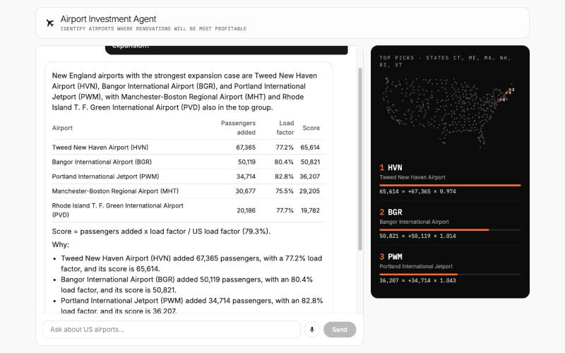
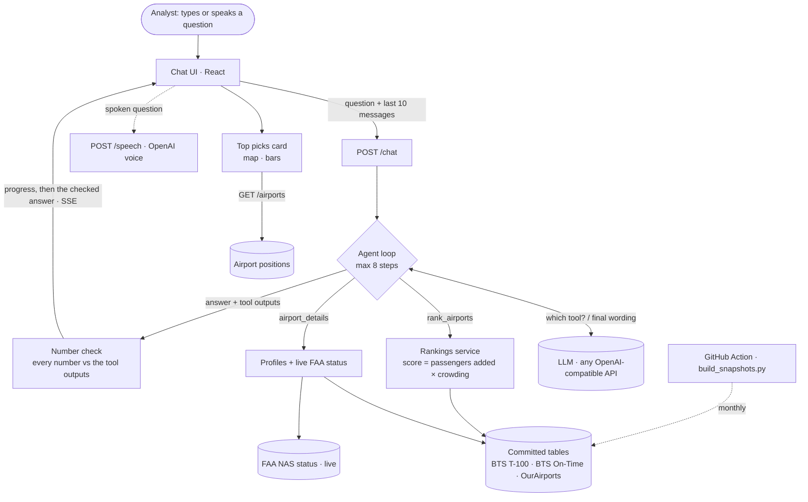

# Airport Investment Agent

An AI agent that helps analysts find US airports where renovation is most profitable, based on increased flight and passenger capacity. Ask in plain language; it ranks airports with a deterministic score (passengers added × how full the airport's flights are versus the US average) built from public BTS and FAA data, and cites the source of every number.



- **How it works, the scoring and the tradeoffs:** [docs/DESIGN.md](docs/DESIGN.md)
- **Every design decision and the options considered:** [docs/DECISIONS.md](docs/DECISIONS.md)

## How it works



- AI picks the tools and writes the words.
- Code computes, ranks and checks every number.
- The browser keeps the conversation, so the server has no state.

## Run it

Requires Docker.

```bash
cp apps/api/.env.example apps/api/.env   # then paste your API key into LLM_API_KEY
docker compose up --build
```

Open http://localhost:5173.

The default model is OpenAI `gpt-5.4-mini` (about 5 seconds per answer). For Gemini's free tier, set `LLM_PROVIDER=gemini` and a Gemini key; it allows only about 5 questions a day. Any other OpenAI-compatible API works with `LLM_BASE_URL` and `LLM_MODEL`.

## Try

- Which airports in New England are strong candidates for terminal expansion?
- Compare LA and Santa Ana airport congestion levels.
- What is the percentage of long haul flights out of Anchorage airport?
- What is the unmet flight demand in SFO airport and why?
- Then a follow-up, e.g. "Which one is more congested?"

**Voice:** click the microphone (Chrome, Edge or Safari) and ask; it sends after 2.5 seconds of silence and reads the answer aloud, except tables (a natural OpenAI voice with the OpenAI provider, the browser's voice otherwise). Stop ends the reading.

The footer under each answer lists its sources and whether every number matched the data.

## Test

```bash
cd apps/api
uv run pytest                                   # 36 tests, no API key needed
uv run --env-file .env python -m scripts.eval_agent   # the sample questions against the real agent (a few cents)
```

## Refresh the data

The tables in `apps/api/data/` cover the newest 12 months BTS has published. A GitHub Action rebuilds them when BTS publishes a new month. To rebuild by hand:

```bash
docker compose run --rm -v "$PWD/apps/api:/app" api python scripts/build_snapshots.py
```

## Layout

```
apps/api/    FastAPI: data modules (airports, rankings + KPI, live_status) and the chat agent
apps/web/    React chat UI
docs/        DESIGN.md, DECISIONS.md
```
