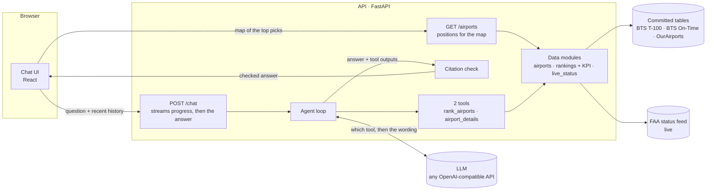

# Design

An AI agent that helps analysts find US airports where renovation is most profitable, based on increased flight and passenger capacity. It answers questions in a chat, ranks airports with deterministic scoring, and cites the data behind every number.

The decision log with every option considered is in [DECISIONS.md](DECISIONS.md).

## Architecture



**AI decides what to look up and how to say it. Code computes every number.** The data modules (`airports`, `rankings`, `live_status`) never import anything LLM-related.

## Data

| Source | What it gives | How it is accessed |
|---|---|---|
| BTS T-100 (data.bts.gov API) | Passengers, seats, departures per airport and month | Monthly, by a build script |
| BTS On-Time Performance (monthly files) | Every domestic flight: delays, delay causes, scheduled duration | Monthly, by the same script |
| OurAirports | Airport name, city, state, runways | Monthly, by the same script |
| FAA NAS Status | Ground stops, delay programs, closures right now | Live, by a tool, when a question needs it |

Each source is accessed at the rate it changes. `apps/api/scripts/build_snapshots.py` builds three small CSV tables for the newest 12 months BTS has published (currently May 2025 – April 2026), plus the 12 months before for growth. The app only reads those tables. On-Time files are about 30 MB a month and slow to download, so turning them into a 356-row table once is what makes answers take seconds.

## Scoring methodology

The question is "where will renovation pay off?" Renovation adds capacity, so it pays off where demand is growing and the airport is already fuller than average.

```
score = max(passengers added, 0) × crowding
passengers added = passengers in the latest 12 months − passengers in the 12 before
crowding = airport load factor ÷ US load factor        (rounded to 3 decimals; above 1 = fuller than average)
```

Load factor is passengers ÷ seats (BTS T-100). The US load factor is the sum of passengers over the sum of seats across every airport in the table (currently 79.3%). The score uses the rounded crowding, so `passengers added × crowding` shown in an answer equals the score exactly. An airport with no seats has no crowding and scores 0, and so does any airport that lost passengers.

**Worked example (ORD).** 41,990,769 passengers vs 39,102,984 the year before: +2,887,785 added. Planes 81.0% full against 79.3% for the US: crowding 1.022. Score: 2,887,785 × 1.022 = **2,951,316**.

**Crowding changes the order.** BNA added more passengers than MCO (+832,437 vs +811,855), but BNA's planes are 75.9% full (crowding 0.957) and MCO's 81.9% (1.032). Scores: MCO 837,834, BNA 796,642. MCO ranks above BNA.

**Deliberately not in the score:** dollars and return on investment (no public source gives revenue per passenger or renovation costs, and the model would have to invent them), terminal and gate size, and legal or physical limits a renovation cannot fix, such as Santa Ana's (SNA) passenger cap and night curfew. The agent names those limits in words, without numbers. Late departures and delay causes are shown as evidence for "why" questions but are not scored.

**Percentage metrics have a floor.** Rankings by late departures, long-haul share, load factor or crowding skip airports with fewer than 1000 flights a year, since one late flight can be 100%.

## Where and how AI is used

| AI does | Code does |
|---|---|
| Understands the question, picks tools and arguments ("LA" → LAX, "East Coast" → 15 states) | Every number: growth, crowding, score, rankings, counts |
| Writes the explanation from tool results | Checks every number in the answer against the turn's tool outputs |
| Adds short explanations from general aviation knowledge, without numbers | Ranks every airport in the given states, or the whole US, by the score or any metric (passengers, growth, crowding, late departures, long-haul flights) |

**Number check.** The model writes plain text with no citation markers. Code then checks **every number in the answer** against the tool outputs of that turn, and the UI shows a footer under each answer: the sources used (data set, airports, period) and "All N numbers match the data", or the numbers it could not find. An earlier version used inline `[T1]` labels after each number; it was replaced because most answers use one tool call, so the labels were noise, and because unlabeled numbers were not checked at all.

**The agent loop** is about 40 lines without a framework: call the LLM with the tools, run the calls it asks for, repeat until it answers (8 steps at most). The browser sends the last 10 messages, so follow-ups work without server state.

**Voice.** Speech to text uses the browser's Web Speech API (Chrome, Edge and Safari; Chrome sends the audio to Google), and waits for 2.5 seconds of silence before sending, so pauses don't cut a question short. Answers to spoken questions are read aloud, without tables: with the OpenAI provider through `POST /speech` (`tts-1`, sentence by sentence so speech starts in about 2 seconds), otherwise with the best voice the browser has. Stop cuts the speech at any time.

**Building it.** The code was written with Claude Code as a pair programmer; the developer made every design decision, which are logged in [DECISIONS.md](DECISIONS.md).

## Key tradeoffs

| Choice | Instead of | Why |
|---|---|---|
| Committed tables, refreshed on a schedule | Live API calls per question | A live call returns the same monthly data; tables are instant and never go down mid-chat |
| Plain agent loop | LangGraph | One agent, two tools: every line is visible, and the tool-call list feeds the citation check |
| OpenAI SDK against any compatible API | LiteLLM | LiteLLM's current release crashed on every tool call; switching providers is one environment variable |
| `gpt-5.4-mini` as default | Gemini free tier | Gemini allowed about 5 questions a day and was often overloaded; it still works via `LLM_PROVIDER=gemini` |
| Passengers added × crowding ratio | Ramps, weighted indexes, percentiles | One formula an analyst can recompute; 9 of 10 independent proposals converged on it |
| Two tools; the model turns places into states | Four tools and a fixed region list | "Whole US" and "East Coast" failed against the list; the model is good at geography, code does the rest |
| Tools return computed numbers and counts | Letting the model count rows | The model once reported 257 weak airports when the real number was 256 |
| Ranking tool takes states | Model copies airport codes | The model dropped 5 of 287 codes when copying a long list |

## Assumptions, uncertainty and scope

- **US airports only**, 668 with passenger traffic and a commercial airport record.
- **Load factor stands in for capacity.** It measures how full airlines fly, not terminal or gate capacity, which no public dataset covers.
- **Growth is one year** vs the year before; one-off changes (a new airline) show up as growth.
- **T-100 departures include cargo flights**, so passengers per departure is understated at cargo hubs (e.g. Anchorage).
- **Delays and flight lengths cover domestic flights of large US carriers only.** Anchorage's long-haul share (12.3%, flights scheduled over 6 hours) excludes its international flights.
- **The number check is a safety net, not a proof**: a number passes if it appears anywhere in the turn's tool outputs, and it cannot catch a wrong comparison between two correct numbers ("44% is higher than 45%").
- **Model behavior is tested, not guaranteed.** `scripts/eval_agent.py` runs 11 cases (the four sample questions, six more, and a follow-up) with code checks (11/11 in the last two runs; single cases occasionally fail on wording, which is why it is an eval and not a test).

## What I would do next

- Rank delays by the airport/airspace cause only, and add terminal and gate data where airports publish it.
- A manual airport search that shows the profile without the AI, which also works when the LLM provider is down.
- Run the eval in CI against a fixed model version, and store answers for regression review.
- Multi-year trends.
- Growth from the FAA 10-year Terminal Area Forecast instead of last year's actual.
- Long-haul by distance (3,000+ miles) including international flights, from T-100 segment data.
